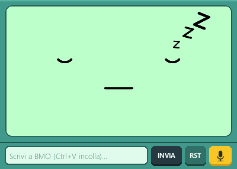

# BMO AI Assistant 🤖 ✨

BMO is an advanced interactive voice and text assistant inspired by the character from *Adventure Time*. It is designed to operate almost entirely **offline**, guaranteeing privacy, data security, and low-latency responses.

> [!WARNING]
> **Work in Progress**: This project is currently under active development. It is currently **functional on Windows PCs** and will be ported to **Raspberry Pi 5** in future releases. Features may change as development progresses; the body has not been printed yet.

> [!IMPORTANT]
> **Privacy & Local Computing**: All models (AI Intelligence, Speech-to-Text, and Text-to-Speech) run **locally on your machine**. The only exception is the web search function, which activates exclusively to retrieve real-time data or fill information gaps on current topics.

## 🖼️ Interface Preview

| Idle State (`IDLE` + Mic Ready) | Speaking / Happy State (Subtitles + Stop Button) |
| :---: | :---: |
|  |  |

## 🚀 Key Features

- **Local Execution**: Run LLMs, Speech-to-Text, and Text-to-Speech locally without sending audio data to external servers.
- **High-Speed Speech Recognition (`faster-whisper`)**: Powered by **Faster-Whisper** (`small`, `int8` quantization + integrated VAD filter) for 3–4x faster Italian transcription and reduced RAM usage.
- **Inline Wake-Word + Question Detection**: Say `"BMO"` alone to get a prompt (*"Dimmi pure"*), or ask directly in a single breath (e.g., *"BMO che ore sono?"*) to skip the intermediate prompt and get an immediate answer.
- **Dynamic Graphical Interface & 7 Expressive States**: A Pygame window (`400x286`) styled with BMO's retro console bezel and synchronized facial animations across 7 states:
  - `IDLE` (sleeping with animated Zzz)
  - `LISTENING` (attentive listening face)
  - `THINKING` (pondering with animated `?`)
  - `SEARCHING` (scanning eyes with animated magnifying glass & radar waves during web searches)
  - `SPEAKING` (lip-sync animation)
  - `HAPPY` (joyful `^ ^` eyes, blush, and twinkling sparkles on greetings and completions)
  - `ERROR` (`X X` eyes and blinking `!` on connection, audio, or timeout errors)
- **Retro Typewriter Subtitles Overlay**: Displays a semi-transparent retro pill at the bottom of BMO's screen with a typewriter reveal effect showing both user questions (`TU:`) and BMO's spoken responses (`BMO:`).
- **Enhanced Input Box & Controls**:
  - Text input supporting **Left/Right/Home/End cursor navigation**, `Delete`/`Backspace`, and **`Ctrl+V` clipboard paste**.
  - **`INVIA` button** (or `Enter`) to submit text queries.
  - **`RST` button** (or `Ctrl+L`) to clear rolling conversation memory on the fly.
  - **Adaptive Mic / Stop (`■`) button** (or `ESC`) to trigger voice listening or immediately interrupt TTS playback while BMO is speaking.
- **Rolling Conversation Memory**: Maintains a configurable rolling history of recent turns (`MAX_HISTORY_TURNS` in `config.json`) so BMO remembers context across follow-up questions.
- **Smart Intent Detection & Fallback Web Search**: Classifies queries into `local` (personal/greetings), `datetime` (real-time system clock/date), or `web` (DuckDuckGo search). If the LLM expresses uncertainty on a local query, it automatically triggers a fallback web search.
- **Color-Coded Terminal Logging & File Logs**: Writes complete logs to `logs/bmo.log` and highlights terminal output using ANSI colors (**bright cyan** for BMO's spoken phrases/responses, **bright yellow** for Whisper transcriptions and user inputs).

## 🛠️ Technology Stack and Libraries

| Library | Model / Purpose | Execution |
| :--- | :--- | :--- |
| `faster-whisper` | Whisper (`small`, `int8` via CTranslate2) — Speech-to-Text | **Local** |
| `ollama` | Gemma 3 (`gemma3:4b`) — LLM Brain | **Local** |
| `piper` | `it_IT-paola-medium` — Neural Text-to-Speech | **Local** (`./piper/`) |
| `ddgs` | DuckDuckGo Search — Real-time web context | Cloud |
| `pygame` | Retro GUI, Subtitles Overlay & Audio Mixer | **Local** |
| `SpeechRecognition` + `PyAudio` | Microphone Audio Input Stream | **Local** |
| `Pillow` | Anti-aliased UI icon rendering & face assets | **Local** |

## ⚙️ How It Works

1. **Monitoring**: In `IDLE` state, `faster-whisper` continuously monitors ambient audio for the **Wake Word** (`"bmo"`).
2. **Inline or Two-Step Capture**:
   - If you say *"BMO che tempo fa oggi?"*, BMO extracts the question immediately and starts processing.
   - If you only say *"BMO"* (or click the Mic button), BMO replies *"Dimmi pure"* and switches to `LISTENING` to record your question.
3. **Intent & Context Building**:
   - **Local**: Greetings and personal questions are answered directly with a `HAPPY` expression.
   - **Date/Time**: Injects the current system time and day of the week in Italian.
   - **Web Search**: Switches to the `SEARCHING` animation and queries DuckDuckGo for up-to-date context.
4. **Reasoning & Uncertainty Fallback**: Queries `gemma3:4b` via Ollama with the system prompt, rolling conversation history, and context. If the model replies with uncertainty phrases and no web search was performed yet, BMO automatically switches to `SEARCHING` and re-queries with live web results.
5. **Synthesized Response & Subtitles**: Piper generates the speech WAV and plays it while the GUI displays the animated face and typewriter subtitles.

## 📥 Installation & Setup

### 1. Clone & Python Environment
```powershell
git clone <your-repo-url>
cd BMO-Ai-assistant
python -m venv virtual
.\virtual\Scripts\Activate.ps1
pip install -r requirements.txt
```
*(Note: The Faster-Whisper `small` model is downloaded automatically on first launch via `WhisperModel("small", device="cpu", compute_type="int8")`.)*

### 2. Install Ollama & LLM Model
1. Download and install **Ollama** from [https://ollama.com/download](https://ollama.com/download).
2. Pull the default model configured in `config.json`:
   ```powershell
   ollama pull gemma3:4b
   ```

### 3. Install Piper TTS & Italian Voice Model (Local `./piper/` Folder)
Piper is kept locally inside the project folder (`./piper/`) and excluded from Git via `.gitignore`:

1. **Download Piper for Windows**:
   - Go to the official Piper releases page: [https://github.com/rhasspy/piper/releases](https://github.com/rhasspy/piper/releases)
   - Download **`piper_windows_amd64.zip`** and extract its contents into `./piper/` inside the project root (so that `./piper/piper.exe` exists).
2. **Download the Preferred Italian Voice Model (`it_IT-paola-medium`)**:
   - Browse all Piper voices (interactive samples): [https://rhasspy.github.io/piper-samples/](https://rhasspy.github.io/piper-samples/)
   - Direct download links for **`it_IT-paola-medium`** on Hugging Face ([model folder](https://huggingface.co/rhasspy/piper-voices/tree/main/it/it_IT/paola/medium)):
     - Model file (`.onnx`): [it_IT-paola-medium.onnx](https://huggingface.co/rhasspy/piper-voices/resolve/main/it/it_IT/paola/medium/it_IT-paola-medium.onnx?download=true)
     - Config file (`.onnx.json`): [it_IT-paola-medium.onnx.json](https://huggingface.co/rhasspy/piper-voices/resolve/main/it/it_IT/paola/medium/it_IT-paola-medium.onnx.json?download=true)
   - Place both `it_IT-paola-medium.onnx` and `it_IT-paola-medium.onnx.json` inside the `./piper/` folder.

### 4. Configuration (`config.json`)
```json
{
    "MODEL_OLLAMA": "gemma3:4b",
    "WAKE_WORD": "bmo",
    "PIPER_PATH": "./piper/piper.exe",
    "PIPER_MODEL": "./piper/it_IT-paola-medium.onnx",
    "WHISPER_MODEL_TYPE": "small",
    "BASE_FACES_PATH": "./assets/faces",
    "OUTPUT_WAV": "assets/recs/bmo_voice.wav",
    "TEMP_INPUT_WAV": "assets/recs/temp_audio.wav",
    "MAX_HISTORY_TURNS": 6,
    "MAX_RESPONSE_WORDS": 15,
    "AUDIO_VOLUME": 1.0,
    "FOLDER_NAMES": {
        "IDLE": "idle",
        "LISTENING": "listening",
        "THINKING": "thinking",
        "SPEAKING": "speaking",
        "HAPPY": "happy",
        "SEARCHING": "searching",
        "ERROR": "error"
    }
}
```

## 🖥️ Running & Real-time Debugging

Run the assistant with:
```powershell
.\virtual\Scripts\python.exe bmo-main.py
```

If Windows does not use your desired microphone by default, run `mic-check.py` to list detected audio input device indices:
```powershell
.\virtual\Scripts\python.exe mic-check.py
```

During execution, logs are saved to `logs/bmo.log` and printed to the terminal with color highlights (verbose HTTP/network debug logs from third-party libraries such as `httpx`, `httpcore`, and `urllib3` are automatically silenced so only clean BMO events and the `Ollama raggiungibile ✓` confirmation appear):
- **Bright Yellow**: User voice transcriptions (`Whisper → ...`, `Domanda ricevuta: ...`) and text inputs (`Input testuale: ...`).
- **Bright Cyan**: Everything BMO speaks (`BMO pronuncia: ...`) and generates (`Risposta BMO: ...`).
- **Standard Output**: Ollama connectivity check (`Ollama raggiungibile ✓`), state transitions, intent detection, DuckDuckGo search queries, and system diagnostics.

## 📦 Assets

**All original components:**
- ✅ **Code**: Written from scratch
- ✅ **Face Images & Animations**: 100% original custom artwork with retro console frame across 7 folders (`idle`, `listening`, `thinking`, `speaking`, `happy`, `searching`, `error`)
- ✅ **Architecture**: Multi-threaded event-driven design (`BMOConfig`, `BMOState`, GUI & Voice workers)
- ✅ **AI Integration**: Ollama + Gemma 3, Faster-Whisper (`int8`), Piper TTS
- ✅ **Web Search Logic**: Intent classifier + automatic uncertainty fallback
- ✅ **GUI System**: Custom Pygame implementation with typewriter subtitles, cursor-navigable text bar (`Ctrl+V`), history reset (`RST`), and adaptive Mic/Stop button

### Disclaimer
> [!IMPORTANT]
> **This is a fan creation.** BMO and Adventure Time are properties of **Cartoon Network**. This project is not affiliated with, endorsed by, or associated with Cartoon Network or any of its parent companies. This project is created for educational and personal use only.

---

## 📜 License & Attribution

This project is released under the **MIT License**.

### Third-Party Dependencies

| Component | License | Purpose |
| :--- | :--- | :--- |
| **Faster-Whisper (CTranslate2)** | MIT | Lightweight Speech-to-Text engine (no PyTorch dependency) |
| **Ollama** | MIT | LLM runtime and inference |
| **Gemma 3** | Google Terms | Language model |
| **Piper TTS** | MIT | Text-to-Speech synthesis |
| **Pygame** | LGPL | Graphics and audio rendering |
| **DuckDuckGo Search** | MIT | Web search results |
| **SpeechRecognition** | BSD-3-Clause | Audio input stream handling |
| **Pillow** | HPND | UI icon rendering |
